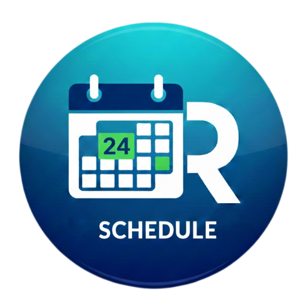
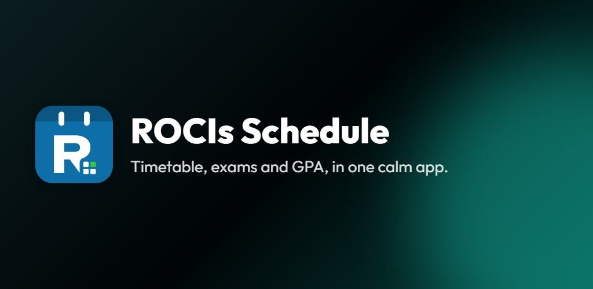
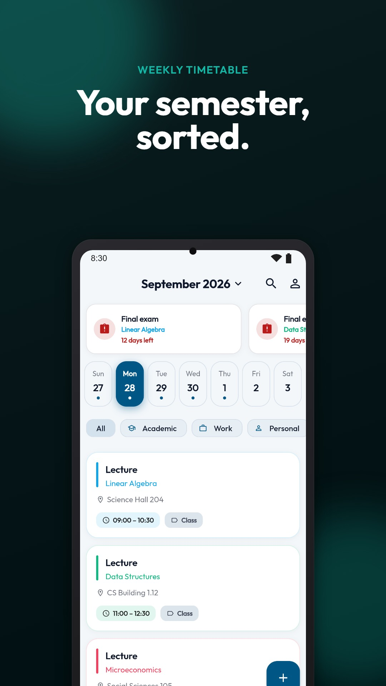
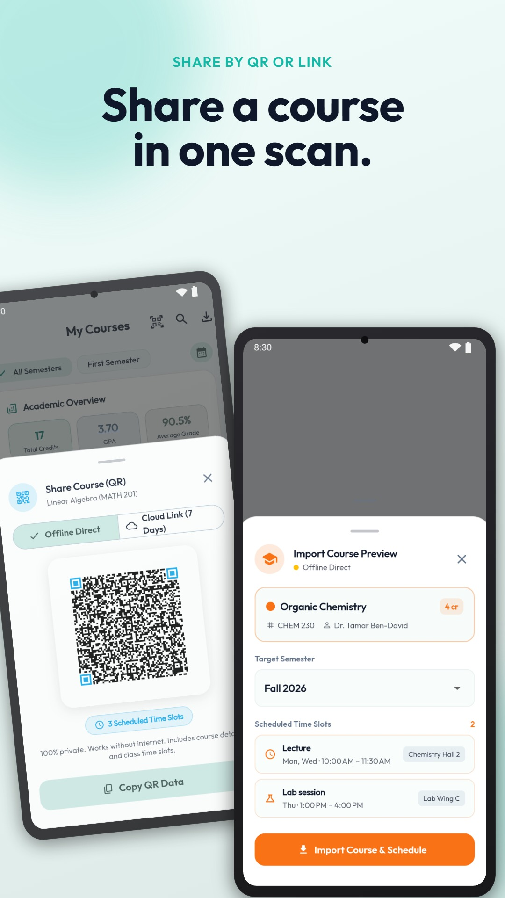
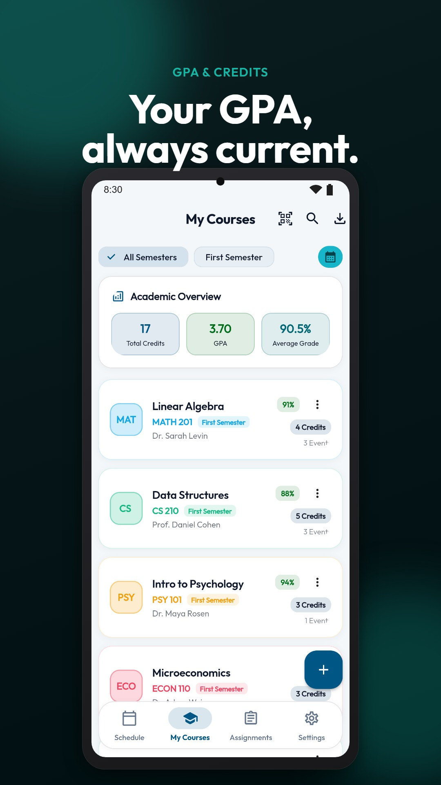
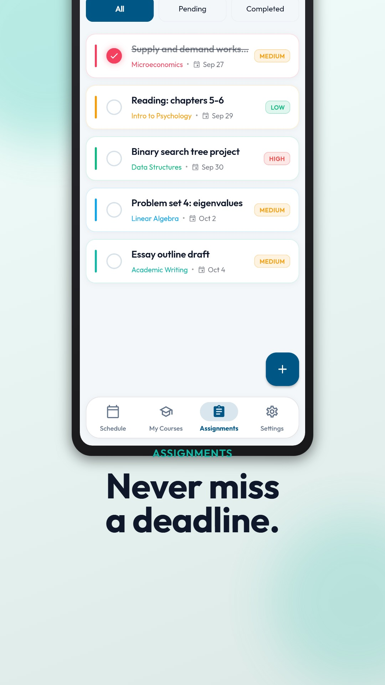
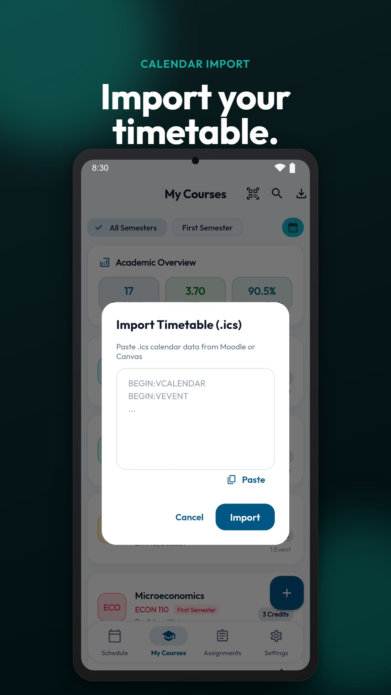
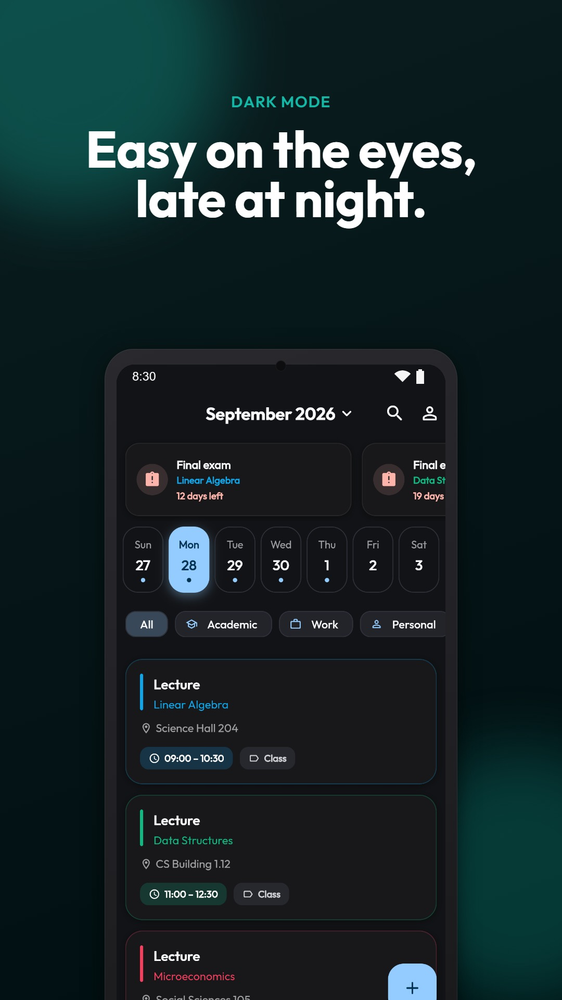
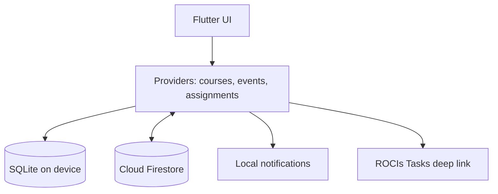

<div align="center">

  

  # ROCIs Schedule
  **A semester planner for students: timetable, exams, assignments and GPA in one app.**

  [](https://flutter.dev)
  [](https://dart.dev)
  [](https://github.com/RoeeIlouz/ROCIs-Schedule/actions/workflows/build_and_release.yml)
  []()
  [](LICENSE)

  <br />

  

</div>

---

> **Status:** open beta on Android. Want in? Email [support@rocisapps.com](mailto:support@rocisapps.com?subject=ROCIs%20Schedule%20beta) with the Google account on your phone. More at [rocisapps.com](https://rocisapps.com/#schedule).

## What it does

- **Weekly timetable** with colour-coded courses, recurring lectures and labs, and room and instructor on every block. Press and hold an event to preview it.
- **Exam countdowns** pinned to the top until the exam is over.
- **GPA tracker** with weighted credits (decimal credits like 1.5 or 3.5 work) on a 4.0 scale.
- **Assignments** with due dates and priorities, and a one-tap hand-off to [ROCIs Tasks](https://github.com/RoeeIlouz/ROCIsTasks-Public).
- **.ics import** from Canvas, Moodle, Blackboard or Google Calendar, with automatic lecture / exam / lab detection.
- **Course sharing** by QR code or link, so a whole class can import the same course.
- **8 languages**, including Hebrew and Arabic with full right-to-left layout.

## Screenshots

<div align="center">
  <table>
    <tr>
      <td width="33%"></td>
      <td width="33%"></td>
      <td width="33%"></td>
    </tr>
    <tr>
      <td align="center"><b>Weekly Timetable</b></td>
      <td align="center"><b>Course Sharing (QR / Link)</b></td>
      <td align="center"><b>GPA & Credits</b></td>
    </tr>
    <tr>
      <td width="33%"></td>
      <td width="33%"></td>
      <td width="33%"></td>
    </tr>
    <tr>
      <td align="center"><b>Assignments</b></td>
      <td align="center"><b>Calendar Import</b></td>
      <td align="center"><b>Dark Mode</b></td>
    </tr>
  </table>
</div>

## How it works



- **Offline first.** Everything is stored in SQLite on the device, so the app works with no account and no connection.
- **Optional sync.** Signing in with Google mirrors your data to Firestore so it follows you across devices. Security rules scope every document to its owner. Shared courses are short-lived snapshots that can be opened by ID but never listed.
- **Reminders** are scheduled locally with time-zone awareness, so they fire on time without a server.
- **Updates** ship through Shorebird code push for Dart-only fixes, and full builds go through GitHub Actions.

**Stack:** Flutter, Dart 3, Provider, go_router, sqflite, Firebase Auth + Firestore, flutter_local_notifications, Shorebird.

## Run it locally

```bash
git clone https://github.com/RoeeIlouz/ROCIs-Schedule.git
cd ROCIs-Schedule
flutter pub get
flutter analyze
flutter test
flutter run
```

Cloud sync needs your own Firebase project (`flutterfire configure`). Without it the app still runs fully offline.

## License

MIT. See [LICENSE](LICENSE).
